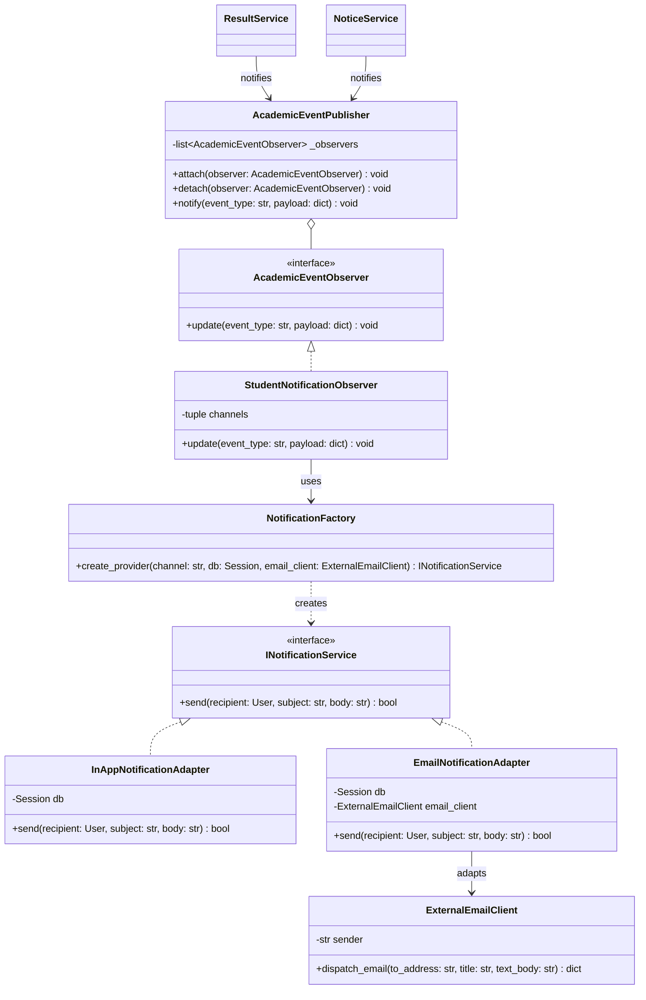

# Design Patterns Documentation — SUAMS

SUAMS implements three Gang of Four (GoF) design patterns across its notification subsystem (`app/patterns/`), working together cleanly to decouple core academic operations from notification delivery.

---

## Pattern Relationships UML Class Diagram

---

## 1. Factory Pattern (Creational) — `app/patterns/factory.py`

### Problem It Solves
Business services and observers need notification channels (`"in_app"`, `"email"`, and future channels like `"sms"` or `"push"`) without hardcoding constructor dependencies or duplicating `if/elif` instantiation logic across the codebase.

### Implementation
`NotificationFactory.create_provider(channel, db=..., email_client=...)` inspects the requested channel identifier, validates it, and returns an initialized `INotificationService` instance (`InAppNotificationAdapter` or `EmailNotificationAdapter`), raising a `ValueError` for unsupported channels.

### Why It Is Suitable
- **Centralized Object Creation:** Adding a new channel only updates the factory in one place.
- **Open/Closed & Dependency Inversion:** Consumers depend solely on `INotificationService` rather than concrete adapter classes.

### Rejected Alternative & Why
- **Alternative:** Direct inline instantiation (`if channel == "email": ...`) inside `StudentNotificationObserver` and routers.
- **Why Rejected:** Tightly couples callers to concrete constructors and scatters validation/error handling across multiple modules.

---

## 2. Adapter Pattern (Structural) — `app/patterns/adapters.py`

### Problem It Solves
Different notification backends expose incompatible interfaces. For example, `ExternalEmailClient` expects `dispatch_email(to_address=..., title=..., text_body=...) -> dict`, whereas internal SUAMS database persistence writes `Notification` ORM rows.

### Implementation
- **Target Interface:** `INotificationService` defines `send(recipient: User, subject: str, body: str) -> bool`.
- **Adaptees & Adapters:**
  - `EmailNotificationAdapter` wraps `ExternalEmailClient`, translates `User.email`, `subject`, and `body` into `dispatch_email(...)`, and logs delivery in SQLite.
  - `InAppNotificationAdapter` adapts SQLAlchemy `Session` persistence into the same `send(...)` contract.

### Why It Is Suitable
- **Uniform Contract:** Callers invoke `provider.send(user, subject, body)` identically regardless of delivery mechanism.
- **Mock-Friendly Testing:** Unit tests can mock `ExternalEmailClient` cleanly (`MagicMock(spec=ExternalEmailClient)`) without touching a real SMTP server.

### Rejected Alternative & Why
- **Alternative:** Modifying callers to invoke `dispatch_email(...)` directly or writing separate service functions per provider.
- **Why Rejected:** Leaks third-party API signatures into domain code and forces branching logic wherever notifications are sent.

---

## 3. Observer Pattern (Behavioral) — `app/patterns/observer.py`

### Problem It Solves
Publishing a result (`ResultService`) or an announcement (`NoticeService`) should automatically notify affected students without embedding notification delivery logic inside grading or notice persistence methods.

### Implementation
- **Subject:** `AcademicEventPublisher` maintains subscriber lists with `attach()`, `detach()`, and `notify(event_type, payload)`.
- **Observer:** `StudentNotificationObserver` implements `AcademicEventObserver.update(event_type, payload)`, resolves recipients (the single student for `result_published`, or course-enrolled/role-targeted users for `notice_published`), and dispatches messages through `NotificationFactory`.

### Why It Is Suitable
- **Loose Coupling:** `ResultService` and `NoticeService` remain focused on grading and notice persistence; new reactions (e.g., audit logging, analytics) can attach as additional observers without editing existing services.

### Rejected Alternative & Why
- **Alternative:** Calling `InAppNotificationAdapter.send()` directly inside `ResultService.publish_result()` and `NoticeService.publish_notice()`.
- **Why Rejected:** Couples core academic transactions to notification side effects and makes adding secondary subscribers require editing core business methods.
