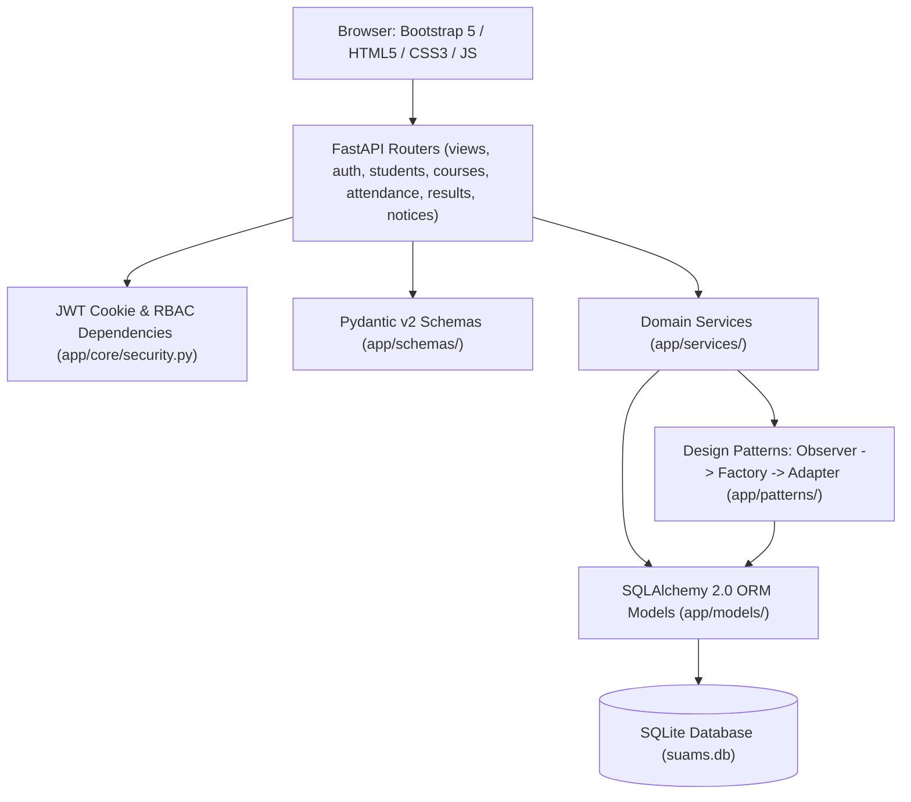
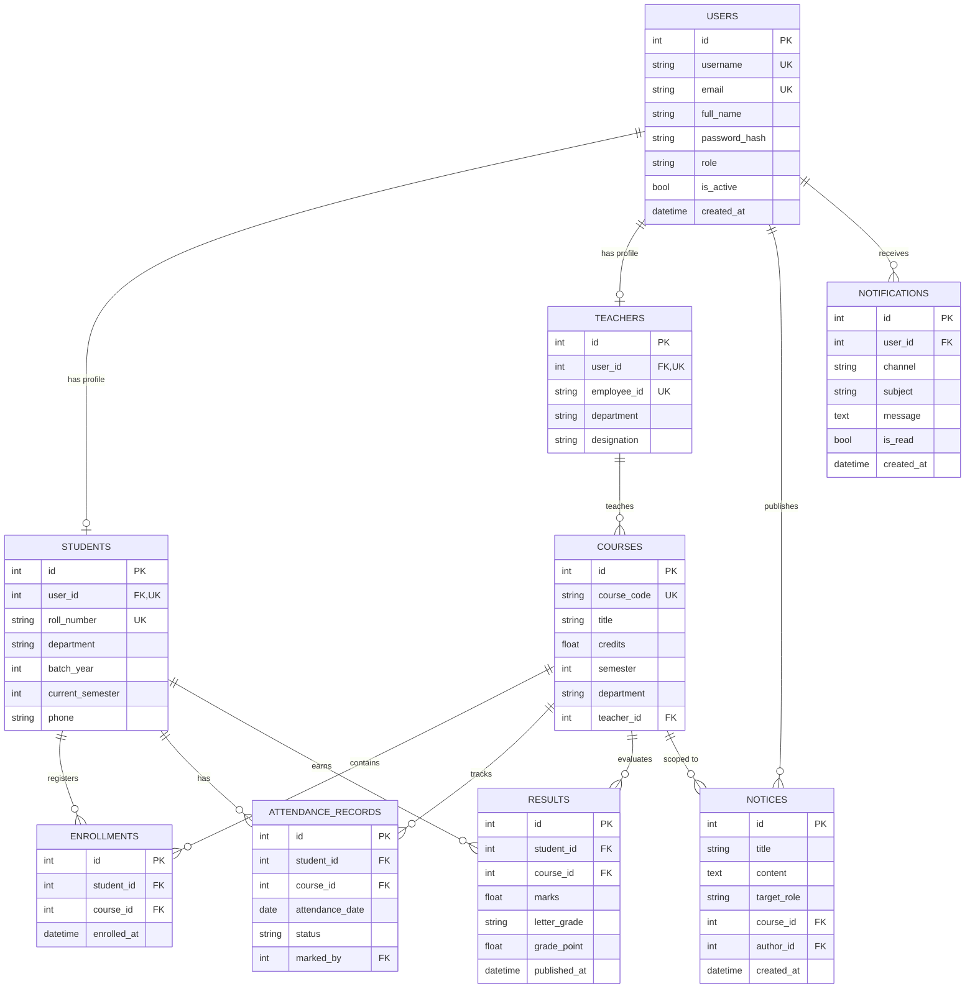
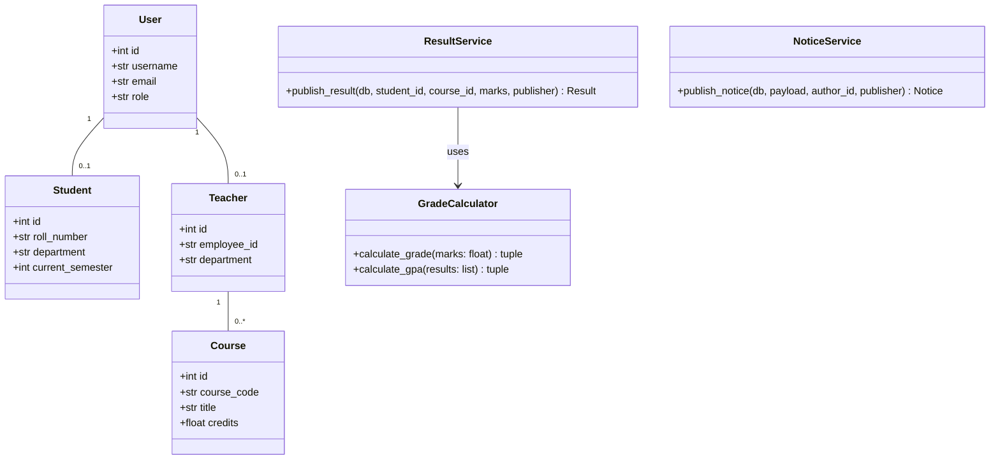

# SDLC, System Architecture, and Diagrams — SUAMS

## 1. Software Development Life Cycle: Incremental Development Model

SUAMS follows the **Incremental Development Model**, delivering the system in vertical, test-verified increments:

1. **Increment 0:** Core configuration, SQLAlchemy/SQLite engine, Pytest & CI setup.
2. **Increment 1:** Authentication & RBAC (`feature/authentication`).
3. **Increment 2:** Student Management (`feature/student-management`).
4. **Increment 3:** Course & Enrollment Management (`feature/course-management`).
5. **Increment 4:** Attendance Management (`feature/attendance`).
6. **Increment 5:** Result & Grade Management (`feature/results`).
7. **Increment 6:** Notices & Notification System using Factory, Adapter, and Observer (`feature/notifications`).
8. **Increment 7:** Expanded Integration Tests, Selenium UI Suite, Coverage Audit & Documentation (`test/unit-tests`, `docs/project-documentation`).

### Why Incremental Development Fits SUAMS
- **Dependency-ordered delivery:** Auth and Student profiles naturally precede Enrollment, Attendance, and Results.
- **Continuous verification:** Every increment runs through TDD (`Red -> Green -> Refactor`) before merging via Pull Request.
- **Reduced integration risk:** Complex cross-cutting patterns (Observer + Factory + Adapter) are integrated cleanly after domain models stabilize.

---

## 2. System Architecture

---

## 3. Database Entity-Relationship (ER) Diagram

---

## 4. UML Class Diagram

